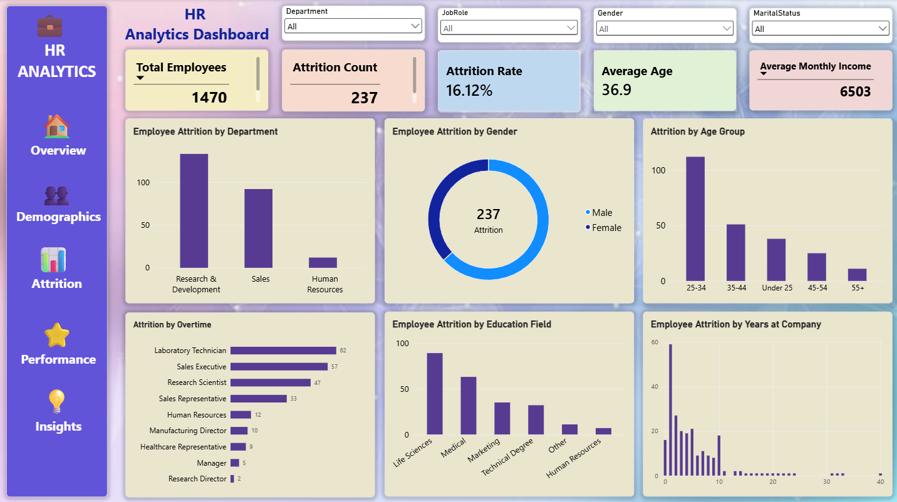

# HR Employee Attrition Analysis

## Project Overview
This project analyzes employee attrition using HR data and an interactive Power BI dashboard. It aims to understand workforce trends, explore employee turnover patterns, and identify factors associated with attrition.

## Tools & Technologies
- Microsoft Power BI
- CSV Dataset
- Data Analytics and Visualization

## Project Objectives
- Analyze employee attrition and retention patterns.
- Explore workforce trends across employee groups.
- Identify factors associated with employee turnover.
- Present insights through an interactive Power BI dashboard.

## Project Files
- `HR-Employee-Attrition.csv` — HR dataset
- `HR_Analytics_Dashboard.pbix` — Power BI dashboard file
- `HR_Analytics_Dashboard.png` — Dashboard preview

## Dashboard Preview

## How to Use
1. Download or clone this repository.
2. Open `HR_Analytics_Dashboard.pbix` using Microsoft Power BI Desktop.
3. If prompted, verify the dataset path and update the data source.
4. Refresh the data if required.
5. Explore the dashboard visuals and insights.

## Key Learning Outcomes
- Working with HR datasets.
- Exploring employee attrition patterns.
- Building interactive Power BI visualizations.
- Communicating data insights effectively.

## Project Type
Data Analytics | Human Resources Analytics | Power BI

---
Created as part of my Data Analytics portfolio.
